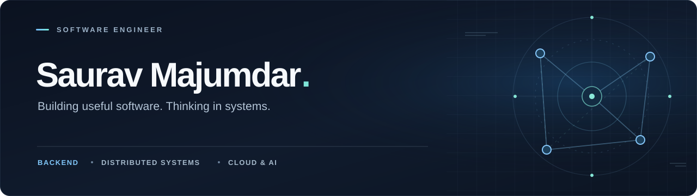

  

   

  <a href="https://www.linkedin.com/in/majumdarsourav/">LinkedIn</a>
  &nbsp;&nbsp;·&nbsp;&nbsp;
  <a href="mailto:souravmajumdar.dev@gmail.com">Email</a>
  &nbsp;&nbsp;·&nbsp;&nbsp;
  <a href="https://github.com/souravdev-eng">GitHub</a>

 

### Hey, I'm Saurav.

I'm a full-stack software engineer drawn to the engineering behind great products — not just how they look and work, but how they **scale, recover, and evolve**.

I enjoy building across the stack, with a particular interest in **backend systems, databases, distributed architecture, and practical AI**. I like getting into the details, questioning trade-offs, and making complicated things simpler.

 

### What I work with

| | |
| :-- | :-- |
| **Languages & frontend** | TypeScript · JavaScript · Go · React · Next.js |
| **Backend & APIs** | Node.js · Express · REST · GraphQL |
| **Data & messaging** | PostgreSQL · MongoDB · Redis · RabbitMQ · Kafka |
| **Cloud & infrastructure** | AWS · Docker · Kubernetes · Terraform |

 

### What has my attention

↳ &nbsp; **Distributed systems** — designing for failure, consistency, and scale.  
↳ &nbsp; **Database internals** — understanding why queries and storage behave the way they do.  
↳ &nbsp; **Go & backend engineering** — writing simpler, more reliable services.  
↳ &nbsp; **AI in production** — connecting useful AI capabilities to real software.

 

---

  Based in India &nbsp;·&nbsp; Curious about the details &nbsp;·&nbsp; Always learning

